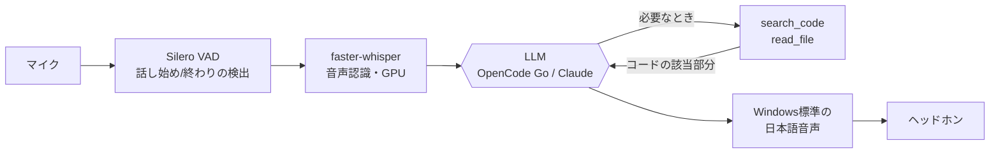

# voice-code-qa

**コードを読みながら、声で答えてくれるAIアシスタント。**
疑問が出たその場で、検索せずに声で聞ける。答えるAIは、渡しておいたコード全体を実際に調べてから話します。

会話のイメージ(説明用の例です):

```
あなた : ログインの処理は、どこに書いてありますか?
ボット : 確認しますね。
ボット : auth.py の login 関数です。main.py の起動時に、ここが呼ばれています。
あなた : パスワードは、どこで確認していますか?
ボット : 同じ login 関数の中で、保存されている値と照らし合わせています。
```

<!-- デモ動画/GIFを docs/demo.gif に置いたら、次の行のコメントを外す

-->

## なぜ作ったか

コードを読んでいて詰まるたびに、手を止めて検索し、チャットにコードを貼り、また読みに戻る。初学者ほど、この往復で集中が切れます。このツールは、その往復をなくすためのものです。

- **想定ユーザー**: プログラミング初学者。他人のコードや、自分が書いた少し前のコードを読んで理解したい人。
- **強み 1 — 声で、すぐ聞ける**: 疑問が出た時点で、手を止めずに口で聞けます。キーボードもブラウザも要りません。
- **強み 2 — コード全体を踏まえて答える**: 質問のたびにコードを貼る必要はありません。フォルダを渡しておけば、AIが必要なファイルを自分で検索して読み、ファイルをまたぐ依存関係も踏まえて答えます。
- **強み 3 — 速い**: 音声認識と音声合成は手元のPCで動きます。外に出る通信は、LLMへのテキストだけです。

## 動作の流れ



1. 話しかけると、VADが話し始めと終わりを検出し、faster-whisperが文字にします。
2. LLMは、ファイル一覧だけを最初から知っています。コードに関わる質問だと、`search_code`(正規表現検索)と`read_file`(行範囲の読み出し)を使って、実際のコードを確認します。
3. 確認の前に「確認しますね」と一言話すので、無言の待ち時間が長く感じません。
4. 答えは、1文ずつ音声合成されて再生されます。話している途中でも、話しかけて割り込めます。

[Pipecat](https://github.com/pipecat-ai/pipecat) の上に作っています。

## セットアップ(Windows / PowerShell, Python 3.11〜3.13)

```powershell
python -m venv .venv
.venv\Scripts\activate
pip install -r requirements.txt
copy .env.example .env      # キーを記入(下の「LLMの選び方」)
python bot.py --check       # キー・LLMの速度・音声認識・日本語音声をまとめて確認
python bot.py C:\path\to\code
```

- **ヘッドホンを使ってください。** スピーカーだと、ボット自身の声をマイクが拾って止まります。
- 初回は音声認識モデル(約1.6GB)をダウンロードします。
- NVIDIA GPUがなくても動きます(`.env` に `WHISPER_DEVICE=cpu`、`WHISPER_MODEL=small` 推奨)。
- 日本語の音声が無い場合は、Windowsの「設定 → 時刻と言語 → 音声」で日本語を追加してください。

## LLMの選び方

答えるLLMは、`.env` で切り替えます。どちらを選んでも、使い方は同じです。

| | キー | 設定 |
|---|---|---|
| **OpenCode Go**(既定) | `OPENCODE_API_KEY` | `OPENCODE_MODEL=mimo-v2.6-flash` |
| **Claude** | `ANTHROPIC_API_KEY` | `LLM_PROVIDER=claude`<br>`CLAUDE_MODEL=claude-haiku-5-5` |

```
# Claudeで動かす .env の例
LLM_PROVIDER=claude
ANTHROPIC_API_KEY=sk-ant-...
```

`python bot.py --check` が、選んだLLMのモデル一覧と「最初の本文が出るまでの秒数」を表示します。声の会話では、この秒数がそのまま体感の速さです。

## 速くするための工夫

声の会話では、数秒の間でも長く感じます。次の点を入れています。

- **思考(reasoning)を切る**: 思考が長いモデルは、本文が出るまで数秒かかり、文字数を思考で使い切って無言になることもありました。OpenCode Goでは `thinking: disabled` を指定します(筆者の環境で、本文まで約0.9秒)。
- **返答を短くする**: 指示で「最大2文・80文字程度」にしています。声は1文ずつ作って順に再生するので、長い答えはそのまま待ち時間になります。
- **調べる回数に上限**: 1つの質問で調べるのは4回までです。足りなければ、分かった範囲で答えて「もっと調べますか」と聞きます。
- **古い調査結果を省く**: 前の質問で読んだコードは、次の質問のとき頭の部分だけ残します。会話が続いても、LLMへの入力が重くなりません。
- **声の出だしが欠けないようにする**: しばらく無音のあと、ヘッドホン側が起き上がる間に声の頭が欠けることがあるので、先頭に短い無音を足します。

## 設定

| 変数 | 既定 | 意味 |
|---|---|---|
| `LLM_PROVIDER` | `opencode` | `opencode` または `claude` |
| `WHISPER_MODEL` | `large-v3-turbo` | 速さ重視なら `small`。手元のモデルのフォルダも指定可 |
| `WHISPER_DEVICE` | `auto` | GPUで落ちるときは `cpu` |
| `TTS_VOICE` | (自動) | Windowsの音声名の一部(例 `Haruka`) |
| `TTS_RATE` | `2` | 話す速さ。-10〜10 |
| `LOG_LEVEL` | `INFO` | `DEBUG` で各段階の待ち時間が見える |

画面には、聞き取り結果(`あなた: …`)、調べたファイル(`[調査] …`)、返答(`ボット: …`)が時刻つきで出ます。聞き間違いや、どこで時間がかかったかを確認できます。

## うまく動かないとき

| 症状 | 対処 |
|---|---|
| 起動時にGPUの警告が出てCPUで動く | `nvidia-smi` が動くか確認。遅ければ `WHISPER_MODEL=small` |
| GPUで突然落ちる(cudnn の DLL エラー) | `.env` に `WHISPER_DEVICE=cpu` |
| 声が出ない・文字だけ表示される | `pip install pywin32`。日本語音声をWindowsに追加 |
| 返事が遅い | `--check` の「最初の本文まで」を見て、軽いモデルに変える |
| `pip install` が `cp932` のエラーで止まる | 日本語版Windowsの問題。このリポジトリの `requirements.txt` は対策済み |

## 今後やりたいこと

オンラインハッカソン「Built with Claude Code: Japan 2026」(Anthropic × Cerebral Valley 主催)に向けて、次の4つを進める予定です。まだ実装していません。

1. **コードの読み込み手順の簡略化** — いまは `python bot.py <フォルダ>` だけですが、GitHubのURLを渡すだけで取り込めるようにする。
2. **応答のさらなる低遅延化** — 話し終わりの判定、最初の一言を返すタイミング、文の区切り方を詰める。
3. **初学者向けの説明** — 該当箇所のファイルと行を画面に示しながら、専門用語をかみ砕いて話す。
4. **変更の影響範囲の提示** — 「この関数を変えたら、どこに影響する?」に、呼び出し元をたどって答える。

## 制限

- コード検索は文字列・正規表現のみです。意味での検索はしません。
- ファイル一覧は先頭400件までをLLMに渡します。巨大なリポジトリは、サブフォルダを指定してください。
- 音声合成はWindows標準の声です。機械的ですが、速さを優先しています。差し替えるときは `make_tts` の部分だけで済みます。
- 現在はWindowsのみ対応です。

## 作り方

このツールは、Claude Code(Claude)と対話しながら作りました。設計の選択(クラウドの音声認識ではなくローカルのWhisperにする、思考を切る、など)は、実機で速度を測りながら決めています。

## ライセンス

MIT License — [LICENSE](LICENSE)
